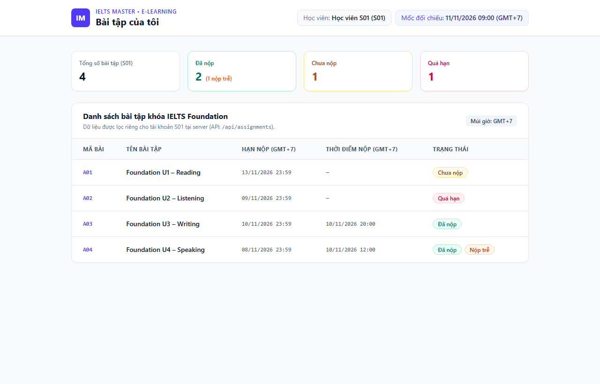

# IELTS Master E-Learning – Chức năng “Bài tập của tôi”

Bài làm kiểm tra chuyên môn vị trí **Junior Full-Stack Developer** tại **Trung tâm IELTS Master**.

Ứng dụng hiển thị danh sách bài tập của học viên giả lập **`S01`** tại thời điểm đối chiếu cố định **`11/11/2026, 09:00 (GMT+7)`**, tính toán chính xác 4 trường hợp trạng thái và đảm bảo cô lập dữ liệu trên server để không làm lộ bài tập **`B01`** của học viên **`S02`**.

---

## 1. Công nghệ sử dụng

- **Framework**: Next.js 15 (App Router) + React 19 + TypeScript
- **Giao diện (UI)**: Tailwind CSS v4 (Responsive trên cả máy tính và điện thoại)
- **Backend / API**: Next.js Route Handler (`GET /api/assignments`) + Tầng Service độc lập
- **Kiểm thử tự động**: Vitest

---

## 2. Cách cài đặt và chạy ứng dụng

### Yêu cầu hệ thống
- **Node.js**: `>= 18.x` (khuyến nghị `20.x` hoặc `22.x+`)
- **npm**: đi kèm cùng Node.js

### Các bước chạy

```bash
# 1. Cài đặt các gói phụ thuộc
npm install

# 2. Chạy môi trường phát triển (Development Server)
npm run dev
```

Sau khi chạy lệnh `npm run dev`, mở trình duyệt tại địa chỉ:
- **Giao diện chính**: `http://localhost:3000`
- **API Endpoint**: `http://localhost:3000/api/assignments`

---

## 3. Cách chạy kiểm thử (Automated Tests)

Dự án đã tích hợp sẵn bộ kiểm thử tự động bằng **Vitest** tại `src/__tests__/assignment.test.ts`:

```bash
npm test
```

### Nội dung kiểm thử bao gồm:
1. **Kiểm thử logic trạng thái (4 trường hợp chuẩn tại mốc `11/11/2026 09:00 GMT+7`)**:
   - `A01` (Hạn `13/11/2026 23:59`, chưa nộp) → **`Chưa nộp`**
   - `A02` (Hạn `09/11/2026 23:59`, chưa nộp) → **`Quá hạn`**
   - `A03` (Hạn `10/11/2026 23:59`, nộp `10/11 20:00`) → **`Đã nộp`** (đúng hạn, `isLate = false`)
   - `A04` (Hạn `08/11/2026 23:59`, nộp `10/11 12:00`) → **`Đã nộp + Nộp trễ`** (`isLate = true`)
2. **Kiểm thử lọc đúng học viên `S01` & chống lộ dữ liệu `S02`**:
   - Service và API `/api/assignments` chỉ trả về `A01`, `A02`, `A03`, `A04` của `S01`.
   - Kiểm thử giả lập request tấn công IDOR `GET /api/assignments?studentId=S02`: API vẫn bỏ qua tham số URL và chỉ trả dữ liệu của `S01`, tuyệt đối không xuất hiện `B01` của `S02`.

---

## 4. Mô tả cách tránh lộ dữ liệu `S02` (Phòng chống lỗi IDOR)

Để ngăn chặn lỗ hổng **IDOR (Insecure Direct Object Reference)** và đảm bảo dữ liệu của `S02` (`B01`) không bị rò rỉ sang `S01`:

1. **Không tin tưởng định danh từ phía Client**:
   - Route Handler `GET /api/assignments` ([`src/app/api/assignments/route.ts`](src/app/api/assignments/route.ts)) **không nhận** `studentId` từ URL query parameters (`?studentId=...`), route params hay custom headers do trình duyệt gửi lên để làm căn cứ xác thực.
2. **Xác định danh tính học viên tại Server (`Server-side Session`)**:
   - Thông tin học viên đang đăng nhập được lấy trực tiếp từ hàm [`getAuthenticatedStudent()`](src/lib/auth.ts) ở phía server (giả lập cơ chế trích xuất từ `HttpOnly Session Cookie` hoặc `JWT` đã ký trong thực tế), cố định trả về `S01`.
3. **Lọc dữ liệu ngay tại tầng Service trên Server trước khi trả về**:
   - Hàm [`getAuthenticatedStudentAssignmentsPayload()`](src/lib/assignmentService.ts) chỉ lọc các bản ghi có `studentId === "S01"` ngay trên server. Dữ liệu `B01` của `S02` bị loại bỏ hoàn toàn trước khi đóng gói JSON gửi qua mạng về trình duyệt (không bao giờ lọc ở phía Frontend).

---

## 5. Ảnh chụp giao diện

Ảnh chụp giao diện thực tế được lưu tại file `screenshot.png` trong thư mục gốc của dự án:



---

## 6. Phần chưa làm / Hướng mở rộng thêm

Trong phạm vi bài test (2–3 giờ, dữ liệu giả lập cố định), các tính năng sau được giữ tối giản và có thể mở rộng khi đưa vào hệ thống thực tế:
- **Xác thực thực tế**: Tích hợp NextAuth.js / Auth.js hoặc JWT lưu trong `HttpOnly Cookie` thay cho hàm session giả lập cố định `S01`.
- **Cơ sở dữ liệu thực tế**: Kết nối PostgreSQL / MySQL thông qua Prisma ORM hoặc Drizzle ORM, đánh index trên cột `(student_id, due_at)`.
- **Tính năng nộp bài & lọc/tìm kiếm**: Bổ sung chức năng tải file bài làm (Writing/Speaking), bộ lọc theo trạng thái và phân trang khi danh sách bài tập lớn.
